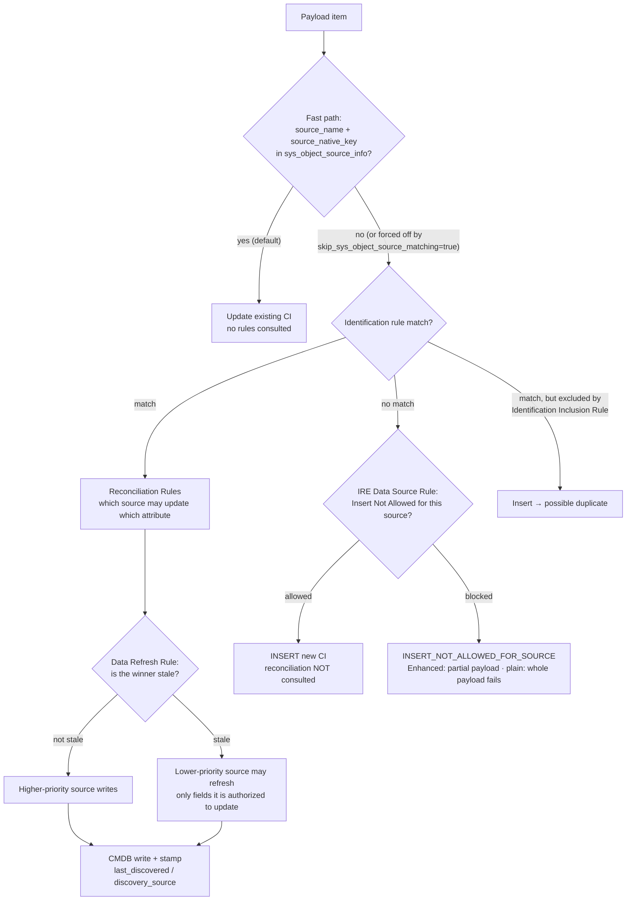
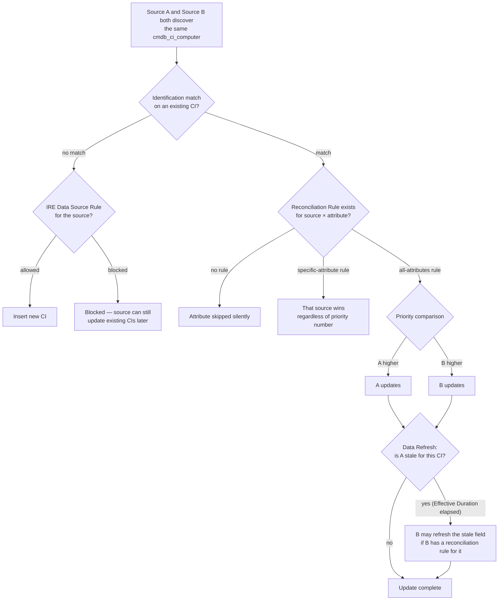
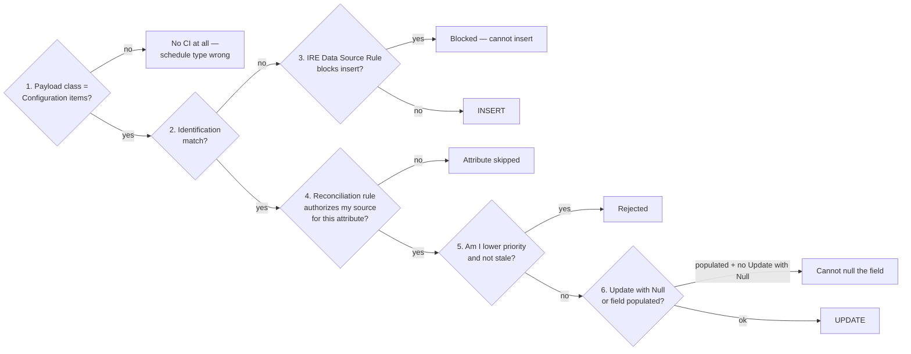

# Discovery Source A vs Source B — Insert vs Update Decision Guide

**De-duplicated from:** `final/FINALINKLING-2-SMALL.MD` (60 KB) and `final/FINALdeepseek-flash.MD` (86 KB).
**Purpose:** the two merged references cover the same IRE/reconciliation ground with heavy overlap and no diagrams. This document keeps the decision logic, drops the repetition, and adds flow charts. It answers one question precisely:

> Under `cmdb_ci_computer`, when **Discovery Source A** and **Discovery Source B** both discover the same machine, **who is allowed to update what — and what does each rule actually do?**

---

## 1. The only four rules that matter

Everything in IRE reduces to four mechanisms. If you know these, you can reason about any configuration.

| # | Rule family | Table | Scope | **Insert** | **Update** | Question it answers |
|---|---|---|---|---|---|---|
| 1 | **Identification Rule** | `cmdb_identifier` + `cmdb_identifier_entry` | per class (derived by children; a child rule **replaces** the inherited one) | **YES** — no match ⇒ create | **YES** — match ⇒ update | "Does this CI already exist?" |
| 2 | **IRE Data Source Rule** | `cmdb_ire_data_source_rule` | class × source (one active per pair; child overrides parent) | **YES — gate** (may block insert) | **NO** — cannot block updates | "Can this source create a new CI of this class?" |
| 3 | **Reconciliation Rule** | `cmdb_reconciliation_definition` (static) / `cmdb_dynamic_reconciliation_definition` (dynamic) | class × source × attribute (or all attributes) | **NO** | **YES** | "Which source may update which attribute?" |
| 4 | **Data Refresh Rule** | Reconciliation surface (`Effective Duration`) / `cmdb_datasource_staleness` (non-CMDB) | class × source | **NO** | **YES** — only when the higher-priority source is **stale** | "Has the higher-priority source stopped refreshing this CI?" |

**Order of application (this is the whole game):**

1. **Identification** runs first. Match, or no match.
2. **Match** → **Reconciliation** decides which source may update which attribute; **Data Refresh** can then let a lower-priority source refresh a field the higher-priority source has let go stale.
3. **No match** → **IRE Data Source Rule** is the *only* gate: it decides whether this source may insert at all.
4. **Reconciliation and Data Refresh are never applied to an insert.** IRE Data Source Rules are never applied to an update.

> Adjacent mechanisms that are **not** one of the four: Identification Inclusion Rule (scoping filter), Reclassification (class-change control), De-duplication Task (output of duplicate detection), Dynamic IRE (extension of reconciliation), Partial/incomplete payloads (processing outcome).

---

## 2. The IRE pipeline (per payload item)



**Fast path caveat:** the `sys_object_source_info` fast path requires **both** `source_name` and `source_native_key` on the payload item. It bypasses all four rule families. If native keys churn while attributes are stable, set `glide.identification_engine.skip_sys_object_source_matching=true` to force rule matching.

---

## 3. Source A vs Source B under `cmdb_ci_computer`

`cmdb_ci_computer` sits under `cmdb_ci_hardware` and **derives the base Hardware identification rule** unless a rule is defined at the computer class. The base Hardware rule matches on:

`serial_number`, `serial_number_type`, `name`, `ip_address`, `mac_address` — plus the **Serial Number** and **Network Adapter** lookup tables.

So when Source A and Source B both report the same machine, the outcome depends on **which attributes they share and who has authority**.

### 3.1 Decision flow



### 3.2 Worked scenarios

| # | Scenario | What happens | Decided by |
|---|---|---|---|
| 1 | A and B both find the machine; A has a reconciliation rule for `name`, B does not | A writes `name`; B's `name` is skipped | Reconciliation |
| 2 | A and B both have all-attributes rules; A priority 100, B priority 200 | A wins every attribute | Priority (lower number wins) |
| 3 | A has an all-attributes rule; B has a rule for `serial_number` only | **B wins `serial_number`** even though A is higher priority | Specific-attribute beats all-attributes |
| 4 | A is stale (Data Refresh Effective Duration elapsed); B has a rule for `ip_address` | B may refresh `ip_address` | Data Refresh + Reconciliation |
| 5 | Machine is new; B is blocked by an IRE Data Source Rule | B cannot insert; A can. B may still update later | IRE Data Source Rule |
| 6 | Both sources report the same machine but the CI is hidden by an ACL/query BR | IRE cannot see the CI ⇒ **insert ⇒ duplicate** | Platform (ACL / BR / domain) |
| 7 | `duplicate_of` is already set, or `discovery_source = Duplicate` | IRE refuses to match ⇒ insert ⇒ duplicate | KB0869861 troubleshooting |

### 3.3 The one-line answer

> **A source is allowed to update an attribute when (a) identification matched an existing CI, and (b) a Reconciliation Rule authorizes that source for that attribute — subject to priority, the specific-beats-all rule, and Data Refresh staleness. A source is allowed to insert when identification found no match and no IRE Data Source Rule blocks it.**

---

## 4. "Am I allowed to update?" — the 6-question check



---

## 5. What each rule means in plain English

### 5.1 Identification Rule — "does this CI exist?"
- One CI identifier per rule; one or more **identifier entries** (unique attribute sets) with priorities.
- **Independent** (identifies from its own attributes — preferred) vs **Dependent** (needs a parent first — max 2 dependency levels).
- Entry types: **Regular** (CI table — preferred), **Lookup** (related table, e.g. `cmdb_ci_network_adapter` for MAC — costs a join), **Hybrid** (both).
- **Inheritance trap:** a child class derives the parent's rule *including related entries*. Defining a child rule **replaces** it entirely — re-add any related entries you still need.
- Never put `sys_class_name` on an independent rule. If matching depends on class, make a rule per class and set `Applies to`.
- Disable with `Active=false`; never delete. Custom rules must use `Order` values different from the defaults (100/200).

### 5.2 IRE Data Source Rule — "may this source create CIs of this class?"
- **Create-only gate.** It cannot restrict which attributes a source updates, and it cannot block updates to an existing CI.
- Fields: `Active`, `Applies to` (class + children), `Data source`, `Insert Not Allowed`.
- Evaluated **only** when identification found no match.
- A blocked source can still be the `discovery_source` of an **update**.
- No effect once **dynamic reconciliation** is in effect.
- Blocked insert logs `INSERT_NOT_ALLOWED_FOR_SOURCE`; under `CreateOrUpdateCIEnhanced()` the item parks as a partial payload (mergeable later); under plain `createOrUpdateCI()` the whole payload can fail.
- **This is the only way to stop a duplicate being born** — reconciliation cannot do it.

### 5.3 Reconciliation Rule — "which source may update which attribute?"
- **Update-only.** Never applied on insert.
- **Static** (source priority per class/attribute) vs **Dynamic** (CMDB 360 value-based: largest / most-reported). Dynamic wins over static for the same attribute.
- Fields: `Active`, `Discovery source`, `Priority`, `Apply to all attributes` vs explicit `Attributes` list, `Update with Null`, `Filter Condition`.
- **Always list attributes explicitly.** An empty Attributes field ("all") loses to any specific-attribute rule, regardless of priority.
- `Update with Null` lets a source null a listed field; without it, a source cannot null a populated field.
- Empty-field updates are governed by `glide.reconciliation.override.null` (default `true`) — a lower-priority source may fill an empty field.
- Reconciliation is evaluated against the **class in the input payload**, not the class the CI currently lives in. A missing rule for the payload class can cause an unintended class downgrade.
- Rules cannot target system or IRE-specific fields (`discovery_source`, …) and cannot be dot-walked through reference fields.
- With Domain Separation, rules are domain-scoped; parent-domain rules apply to child domains unless overridden.

### 5.4 Data Refresh Rule — "has the higher-priority source gone stale?"
- **Update-only.** Never applies to a new insert.
- Fields: `Discovery source`, `Effective Duration`, `Active`. Also described as **Refreshable** + **Stale threshold** on a reconciliation rule (release-dependent wording).
- `Effective Duration = 0` (default) means the CI is **immediately stale** for that source — a lower-priority source is always authorized to refresh.
- The refresh can only write fields the lower-priority source is authorized to update by Reconciliation Rules. **Refresh is not a license.**
- No effect when dynamic reconciliation rules are in effect.
- Field-specific rules are safer than "apply to all": staleness on `name` should not block a refresh of `serial_number`.
- Staleness is measured against **Data Source History** (`cmdb_datasource_last_update`), not `sys_updated_on`.
- Avoid ping-pong: two sources alternately refreshing each other. Use strict priority for identity fields and staleness-aware refresh only for non-identifying attributes.

### 5.5 Identification Inclusion Rule — "which matched CIs are eligible?"
- Narrows which existing CIs participate in identification **and** in the CMDB Health duplicate metric.
- Class-level `Active record condition`. No predefined baseline in the base system.
- Affects **every** script that calls IRE — apply narrowly.
- **Critical pitfall:** never scope an inclusion rule by `Class` on a parent class table like `cmdb_ci_hardware`. Child classes not named are not found by IRE ⇒ duplicates. Filter on attributes/status instead.

### 5.6 Reclassification — "may the CI change class?"
- IRE can upgrade, downgrade, or switch a CI's class when a match is found.
- `glide.class.{upgrade,downgrade,switch}.enabled` (default `true`).
- `glide.identification_engine.update_without_{upgrade,downgrade,switch}_enabled` (default `false`) — when `true`, process the update but skip reclassification for that direction; these **override** the class flags.
- Payload `settings` flags `updateWithoutUpgrade|Downgrade|Switch` take precedence over properties.
- Blocked ⇒ a **reclassification task** (review in CMDB Workspace) instead of a write.

---

## 6. Insert vs Update — the complete decision table

| Situation | Outcome | Decided by |
|---|---|---|
| Exactly one CI matches (inclusion-eligible) | **Update** attribute-by-attribute | Reconciliation |
| No match + IRE Data Source Rule permits | **Insert** (reconciliation not consulted) | IRE + Data Source Rule |
| No match + IRE Data Source Rule blocks | **Blocked** → partial payload (Enhanced) or payload fail (plain) | IRE Data Source Rule |
| Matched, but match excluded by inclusion rule | **Insert → possible duplicate** | Identification Inclusion Rule |
| Matched, 2+ CIs, count < threshold, `skip_duplicates=true` | Oldest = main; others `duplicate_of`; de-dup task auto | `skip_duplicates` (threshold default 5) |
| Matched, count ≥ threshold or `skip_duplicates=false` | **Match fails**, error logged; de-dup task | threshold |
| Lookup-matched duplicates | Oldest referenced CI chosen; set `glide.identification_engine.lookup_match.create_duplicate_task_ci.enabled=true` to force tasks | property |
| Matched, no reconciliation rule for source × attribute | Attribute skipped silently | static/dynamic |
| Matched, lower-vs-higher priority, non-stale | Lower rejected (first-writer / field-empty governed by `override.null`) | priority + `override.null` |
| Matched, field empty + lower-priority source | Filled (default `override.null=true`) | `override.null` |
| Matched, class move beneficial but blocked | Reclassification task | restriction rules / flags |
| Matched + ACL/BR hides CI from IRE | **Insert → duplicate** | platform (ACLs, query BRs, domain) |
| Scan type anything but `Configuration items` | No CI at all | schedule type |
| `duplicate_of` set or `discovery_source = Duplicate` | IRE refuses to match ⇒ insert ⇒ duplicate | KB0869861 |
| Concurrent discoveries of the same dependent CI | Duplicates | schedule sequencing + platform |

---

## 7. Inclusion rules and metrics — what actually counts

Three different "which CIs count" mechanisms. Do not conflate them.

| Mechanism | What it does | Where | Effect on data |
|---|---|---|---|
| **Identification Inclusion Rule** | Narrows which matched CIs are eligible for identification **and** the duplicate metric | IRE `create-id-inclusion-rule` | Directly changes matching outcomes |
| **CMDB Health duplicate metric** | Scores duplicates for a class | CI Class Manager → Health → Correctness | **Reporting only** — changes no data |
| **CMDB Data Manager policy** | Retires / archives / deletes stale CIs | CMDB Workspace → Data Manager | Lifecycle action on the CI |

**What the duplicate metric counts (by design, narrow):** only classes that have identification rules, and only CIs with an empty `discovery_source` or an active de-dup task. A 0 score does **not** mean "clean".

---

## 8. Staleness — three mechanisms, do not mix them up

| Mechanism | Question it answers | Where | Effect |
|---|---|---|---|
| **Data Refresh Rule** | Has *this discovery source* stopped refreshing this CI? | CI Class Manager → class → Reconciliation Rules → Data Refresh Rules | Allows lower-priority sources to update (**static reconciliation only**) |
| **CMDB Health Staleness Rule** | What % of this class is stale (correctness KPI)? | CI Class Manager → Health → Correctness → Staleness Rule | **Reporting only**; changes no data |
| **CMDB Data Manager Policy** | Should this CI be retired / archived / deleted? | CMDB Workspace → Data Manager | Lifecycle action on the CI |

> Health staleness is based on `sys_updated_on`. Discovery refreshing unchanged data does **not** move `sys_updated_on`, so a CI can look stale in health reporting while Discovery is actively refreshing it.

---

## 9. Rule precedence — the order that actually bites

1. **Dynamic beats static** for the same attribute.
2. **Specific-attribute rule beats all-attributes rule** — regardless of priority number.
3. **Child-class rule beats parent-class rule** (including derived rules).
4. Between two rules for the same attribute at the same class level, **priority** decides (lower number wins).
5. Rules authorizing different sources for the same attribute **coexist**; IRE prevents overwrites using Data Source History (`cmdb_datasource_last_update`).
6. Empty-field updates governed by `glide.reconciliation.override.null` (default `true`).
7. **Insert is never gated by reconciliation** — use IRE Data Source Rules.
8. Domain separation scopes rules per domain.
9. Reconciliation is evaluated against the **payload class**, not the CI's current class.
10. IRE checks `cmdb_datasource_last_update` during reconciliation — a common reason rules "don't seem to work".

---

## 10. Traps that create duplicates (de-duplicated)

1. Weak identifier entries (name-only).
2. Renamed adapters / hostnames ⇒ match breaks (old CI goes `Install Status = Absent`, new one created).
3. Unstable serials or custom serial prefixes.
4. Multiple sources with no authority model.
5. Lookup-table duplication pointing at different CIs.
6. Over-broad or overlapping schedules / behaviors.
7. Multi-page payloads processed in parallel.
8. Inclusion rule class-scoped on a parent class ⇒ children invisible to IRE.
9. ACL / query BR hides the existing CI from IRE.
10. `duplicate_of` set or `discovery_source = Duplicate` ⇒ IRE skips.
11. Manually created CIs with empty source — never reconciled.
12. Custom identifier `Order` collides with the base rule (or `Active` cleared).
13. Reconciliation blocks an update ⇒ a human hand-creates a "real" CI.
14. High-priority source silent ⇒ attributes "frozen" ⇒ re-imports duplicate.
15. Weak identification on a child class while the parent inherits.
16. Defining a lookup-based identifier for a child table in a parent rule **and** a class-level identifier for that child — the two contradict.
17. Adding `name` to distinguish bonded/teamed NICs, then renaming an adapter.

---

## 11. Conflicts and gaps between the two merged references

| Topic | Inkling | deepseek-flash | Resolution |
|---|---|---|---|
| Data Refresh UI wording | "Effective Duration / Stale threshold (release-dependant)" | "Effective Duration / Stale threshold" | Same mechanism; UI wording varies by release |
| Rule precedence | 6-point list | 10-point list | deepseek list is a superset; use it |
| `sys_object_source_info` fast path | Documented with the `skip` property | Not mentioned | Inkling is the source of record here |
| Performance guardrails (payload limits, caches) | Documented in detail | Not mentioned | Inkling is the source of record |
| Reconciliation "evaluated against payload class" | Not mentioned | Documented | deepseek is the source of record |
| Duplicate root causes | 15 items | 14 items | Merged list in §10 |

**Neither document independently verified every claim against a live instance.** Items marked "verify on instance" in the source docs remain open.

---

## 12. Quick reference card

```
PAYLOAD ARRIVES
  │
  ├─ source_name + source_native_key in sys_object_source_info? ── yes ──▶ UPDATE (no rules)
  │
  └─ IDENTIFICATION match?
       ├─ NO  ──▶ IRE DATA SOURCE RULE ── blocked ──▶ INSERT_NOT_ALLOWED_FOR_SOURCE
       │                         └────── allowed ──▶ INSERT (reconciliation NOT consulted)
       └─ YES ──▶ RECONCILIATION (which source, which attribute)
                     ├─ no rule ──▶ skip attribute
                     ├─ specific-attribute rule ──▶ that source wins (beats priority)
                     └─ all-attributes ──▶ priority decides
                           └─ DATA REFRESH: winner stale? ── yes ──▶ lower-priority may refresh
```

**The four rules in one line each:**
- **Identification** — does it exist? (insert + update)
- **IRE Data Source** — may this source create it? (insert only)
- **Reconciliation** — may this source update this field? (update only)
- **Data Refresh** — is the winner stale? (update only, static reconciliation only)

---

*Compiled 2026-11-13 from the two merged agent references in `final/`. Where the sources disagreed, the fuller list was kept and flagged in §11.*
